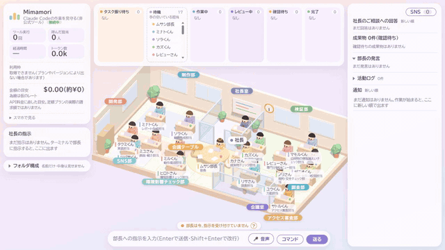
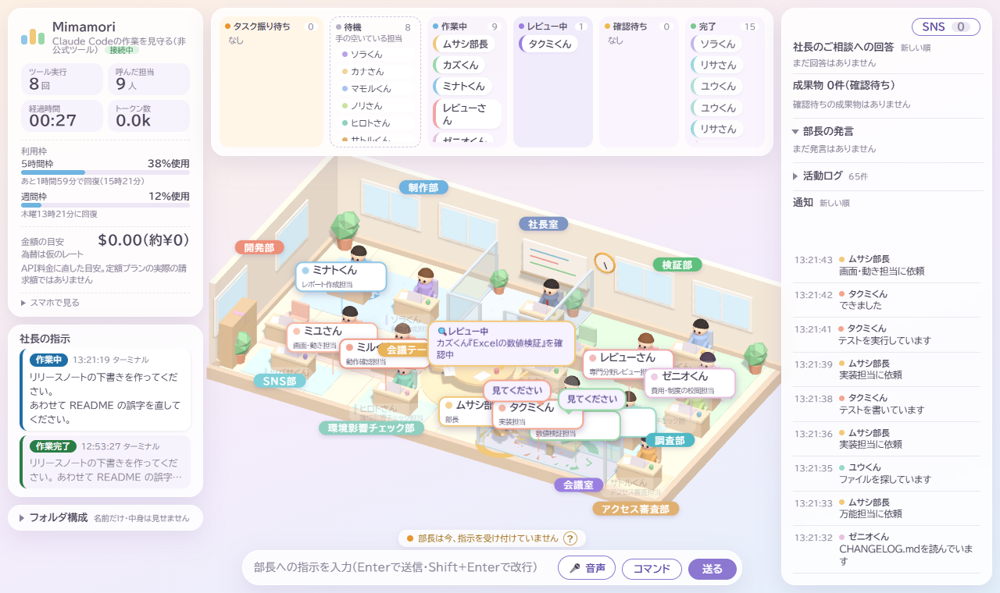

# Mimamori

Claude Code の作業を見守る、ローカル専用の可視化ツールです。

> Mimamori は個人が作った非公式ツールで、Anthropic社とは関係ありません。「Claude Code と連携」する対象の説明としてのみ名前を使っています。



### まず試す(3行)

```
git clone https://github.com/mimamori-dev/mimamori.git && cd mimamori
npm ci
npm start
```

ブラウザで http://127.0.0.1:4317 を開きます。Claude Code の動きを画面に出すには hook の導入が必要です(下の「導入3ステップ」と「hookは何を変えるか」を先に読んでください)。非公式・Windowsのみ確認・保証なしです。

(この文書と画面の「社長」は、あなた(利用者)のことです。)

## 何ができるか

ブラウザ上の3Dオフィスで、Claude Code の部長(メインのClaude)と担当(サブエージェント)が席で動きます。今だれが何をしているか、確認待ちの質問、成果物の登録、経過時間・トークン数・金額の目安・利用枠を、1つの画面で見られます。画面からの判断カードへの回答、指示の送信、スマホからの閲覧と指示の送信もできます(任意。既定では無効)。



## 導入3ステップ

```
npm ci
node tools/install-hooks.mjs --user      # hook を入れる(下の説明を先に読んでください)
npm start
```

1. `npm ci` で依存を入れます
2. hook を入れます。特定のプロジェクトだけなら `--user` の代わりに `--project <フォルダ>` を使います
3. `npm start` を起動します。ブラウザで http://127.0.0.1:4317 を開きます。Claude Code を(再)起動すると画面に動きが出ます

> スマホ用の遠隔は既定で無効です。環境変数 `OFFICE_REMOTE=1` を付けて有効にした場合に限り、起動時のターミナルにスマホ用のURLが出て、合言葉つきのQRはPCの画面に出ます。**その場合は、ターミナルの画面・PCの画面・記録を人に見せないでください**。

### hookは何を変えるか・元に戻し方

hook は、設定ファイル(`--user` なら `~/.claude/settings.json`、`--project` ならそのフォルダの `.claude/settings.json`)に、このフォルダの `office-hook.mjs` を呼ぶ項目を足します。Claude Code のイベントをローカルのサーバーへ送るだけです。

```
node tools/install-hooks.mjs --user --dry-run     # 追加する内容を見るだけ(何も書かない)
node tools/install-hooks.mjs --user --uninstall   # 取り除く(このツールが足した分だけ)
```

- 書き込み前に確認(y/N)があり、`settings.json.bak-日時` のバックアップを作ります。確認を省くなら `--yes`
- 既存の hook はそのまま残し、すでに入っていれば重複して足しません
- 入れる前に Claude Code を閉じてください
- hook の場所は `office-hook.mjs` の絶対パスで入ります。フォルダを移動する前に `--uninstall` で取り除き、移動後に入れ直してください
- **`--project` の注意**: 絶対パス(ユーザー名を含む)を、そのプロジェクトの `.claude/settings.json` に書きます。その `settings.json` を git に入れて公開すると、個人のパスも公開されます。`--user` ならホームの設定(`~/.claude/settings.json`)に書くので、プロジェクトの git には入りません
- **hook の動き**: Claude Code のセッション開始時、サーバーが起動していなければ起動し、画面がどこにも開かれていなければ既定のブラウザを開きます(Windows のみ)。ブラウザを開かせたくないときは環境変数 `OFFICE_NO_BROWSER=1` を設定してください
- ポートは環境変数 `OFFICE_PORT` で変えられます。変えた場合は Claude Code を起動する環境にも同じ値を設定してください
- 元に戻すには `--uninstall`、うまくいかないときは `settings.json.bak-日時` を元の `settings.json` に上書きコピーしてください
- 入れたあと Claude Code を再起動してください

## 動作環境

- Windows で確認済みです(Node.js 26.13.1 のみ実測)
- Node.js 20 系・Mac・Linux は未確認です。動くかもしれませんが保証しません。試した結果は Issues で歓迎します(`package.json` の engines は `>=20` ですが、実測は上記のみです)
- hook でイベントを受け取るため Claude Code が必要です

## 画面の見方

- オフィス: 部長と担当の席。作業中の担当が動き、吹き出しに今の作業が出ます
- 看板(ボード): 作業中・確認待ち・完了などの列で、依頼の状況を並べます
- 右側のパネル: 経過時間・トークン数・金額の目安(API料金に直した目安で、実際の請求額ではありません)・利用枠・指示の一覧・フォルダ構成

## プロジェクトの追加

```
node tools/new-project.mjs <id>   # 例: node tools/new-project.mjs my-app
```

`projects/_template/` を元に `projects/<id>/` を作ります。`id` は小文字英字で始まり、小文字英数字・`_`・`-`、32文字以内です。作ったあと `project.json`(`name`・`color`・`root`)と `roster.json`(名簿)を編集します。各項目の意味は `projects/_template/README.md` にあります。`root` はファイル一覧・成果物登録の基準フォルダ(`null` なら未設定)で、作業フォルダがこの下にある hook をそのプロジェクトに振り分けます。同梱の `projects/demo/`(サンプル)と `projects/apps/` が見本です。壊れた設定は、起動時のターミナルと `npm run doctor` に理由つきで警告が出ます(そのプロジェクトは読み込まれません)。

プロジェクトの置き場所を変えたいときは、環境変数 `OFFICE_PROJECTS_DIR` に `projects/` と同じ構成のフォルダを指定します(未指定なら本体の `projects/`)。
**信頼できる自分のフォルダだけを指定してください。** 指定先の `project.json` の `root` が、ファイル一覧・成果物登録の基準になり得ます。`npm run doctor` は指定先も検査します。`new-project` は `projects/` 固定で指定先には効かないので、指定先では `projects/_template/` をコピーして作ってください。

## 拡張の差し込み口

環境変数 `OFFICE_EXT_DIR` に、`ext.mjs` を置いたフォルダを指定すると、起動時に読み込みます(未指定なら何も変わりません)。見本は `examples/ext-sample/` です。

```js
export default {
  routes: { 'GET /ext/hello': (req, res, ctx) => ctx.json(res, 200, { ok: true }) },
  remoteAllowed: ['GET /ext/hello'], // スマホ遠隔で通す経路。載せない経路は全て 403
  panelsJs: true, panelsCss: true,   // <フォルダ>/public/panels.js・panels.css を /ext/ で配信
};
```

- 本体のどの経路にも一致しない要求だけが `routes` に回ります(本体の経路は上書きできません)。`'GET /パス'`・`'POST /パス'` の形です。
- handler は `(req, res, ctx)`。`ctx` は `info`・`inbox`・`state`・`now`・`json`・`readSmallJson`・`enqueueInstruction`・`opener`・`crossSite(req)`(他サイト由来の要求なら true。本体の操作と同じ判定)・`openGate()`(「開く」操作の最小間隔。通れば true、間隔内は false。本体の「開く」と時刻を共有)・`validOtherText(text, max)`(本体の自由入力の検証。不正なら null)・`extDir`・`dataDir`(`<フォルダ>/data`)です。
- 読み込みの失敗は、ターミナルに警告を出して拡張なしで続行します。handler の同期例外と Promise の失敗は捕まえて警告を出し、500 にします。ただし handler の中で `setTimeout` などに投げた非同期の例外は捕まえられません(本体が落ちることがあります)。
- **信頼できる自分のフォルダだけを `OFFICE_EXT_DIR` に指定してください。** `ext.mjs` は本体と同じ権限で動き、`opener`・`state` にも触れます。
- 拡張の POST 経路には、本体が自動で `crossSite` を適用します(他サイト由来は 403)。GET は副作用を持たない前提で自動の検査はありません。副作用のある GET は、自分で `ctx.crossSite(req)` を呼んでください。
- スマホ遠隔: `remoteAllowed` に POST を書いても、遠隔からの POST は常に 403 です。遠隔の画面にパネルを出すには、`'GET /ext/panels.js'`(CSS も使うなら `'GET /ext/panels.css'`)を `remoteAllowed` に載せてください。

## スマホから見る・指示を送る

外出先のスマホから、画面の閲覧と「指示の送信」だけができます。**この機能は既定で無効**で、環境変数 `OFFICE_REMOTE=1` を付けて起動したときだけ有効になります(Tailscale が必要)。無効のときは Tailscale を探さず、遠隔の口も開かず、合言葉ファイル(`remote.json`)も作りません。有効にすると、この PC の Tailscale の IP(100.64.0.0/10)にだけ口が開きます。

1. PC とスマホの両方に Tailscale を入れ、同じアカウントでログインします
2. `OFFICE_REMOTE=1` を付けてサーバーを起動します(PowerShell なら `$env:OFFICE_REMOTE=1; npm start`、bash なら `OFFICE_REMOTE=1 npm start`)。Tailscale が見つかると、PC の画面に QR が出ます(後から Tailscale を起動しても約30秒で拾います)。Tailscale が入っていない・ログインしていないときは QR は出ず、起動は通常どおり続きます(30秒ごとに探し直します)
3. スマホで QR を読み取ります。合言葉は Cookie(30日、`SameSite=Lax`)に移り、URL からは消えます
4. 画面下の入力欄から指示を送れます。送れるのは既定プロジェクトだけで、1分10件・8KBまでです。判断カード・コマンド・成果物の承認などの書き込みは、スマホからはできません(403)
5. 指示は「受付済み → 作業中 → 作業完了」の3段階で表示されます。受け取った側(`tools/wait-instruction.mjs`)には「遠隔・スマホ」の印が付きます

- 合言葉が漏れた・端末を失くしたとき: `node tools/remote-rotate.mjs`(確認あり、`--yes` で省略)で合言葉を作り直します。世代番号が上がり、既存の Cookie と QR は全て無効になります。サーバーを再起動し、QR を読み直してください
- 安全上の注意: Tailscale で見えるのは自分のアカウントの端末だけにし、画面・QR・合言葉を人に見せないでください。公開インターネットへのポート開放はしないでください。スマホからの指示を、重い承認(削除・上書き・外部への送信・パッケージ導入など)の代わりにしないでください。重い承認は必ず PC のターミナルで確認します
- 音声入力は PC のブラウザ向けです。スマホでは未対応です(PC では録音中に「送る」と言うと停止して送信、「音声入力 終了」で停止します)。`?voicedebug=1` を付けると診断表示が出ます。実ブラウザを使う音声テストは環境変数 `VOICE_E2E=1` を付けたときだけ動きます(PowerShell なら `$env:VOICE_E2E=1; npm test`)

## データとプライバシー

データはこのPCのローカルだけで扱います。画面の会話表示のため、Claude Code の会話記録(transcript)のファイルを読み取りますが、外部へは送りません。既定では、サーバーは `127.0.0.1` だけで待ち受け、データを外部へ送りません。保存先は `data/`(gitに入れません)です。ただし音声入力だけは、ブラウザの提供元(Chrome なら Google など)へ音声が送られます。使いたくなければ音声入力を使わないでください。スマホ用の遠隔は既定で無効です。環境変数 `OFFICE_REMOTE=1` で任意に有効にした場合に限り、この PC の Tailscale の IP にだけ合言葉つきの口が開きます。その場合は画面やQRを人に見せないでください。

## トラブル

まず診断を実行します。結果はそのまま GitHub Issues に貼れます(ホームのフォルダ名は `~` に置き換わります)。

```
npm run doctor                          # hook の確認先は今いるフォルダ
npm run doctor -- --project <フォルダ>   # 別のプロジェクトの hook を確認
```

Node の版・`node_modules`・ポート・プロジェクトの読み込み・hook の導入状況を表示します。

- 画面が真っ白: `node_modules` が無いか不完全です。`npm ci` を実行し、ブラウザを再読み込みしてください
- ポートが使用中: 起動時に「使用中です」と出ます。すでに起動していないか確認し、別のポートにするなら `OFFICE_PORT` を指定します。hook・`tools/` を動かす環境にも同じ値が必要です
- 画面に何も出ない: hook が未導入です(`npm run doctor` の hook の行で確認し、上の「導入3ステップ」で hook を入れてください)

## サポート

サポートは GitHub Issues で行いますが、対応や返信は保証しません。不具合報告には `npm run doctor` の結果を貼ってください。

## 免責

現状のまま(AS IS)で提供します。動作の保証・サポート・更新の約束はありません。利用は自己責任でお願いします。Mimamori は Anthropic社とは関係のない非公式ツールです。

## ライセンス

MIT(`LICENSE`、著作権表記は「Mimamori contributors」)。依存パッケージは `THIRD_PARTY_NOTICES.md` を参照してください。
